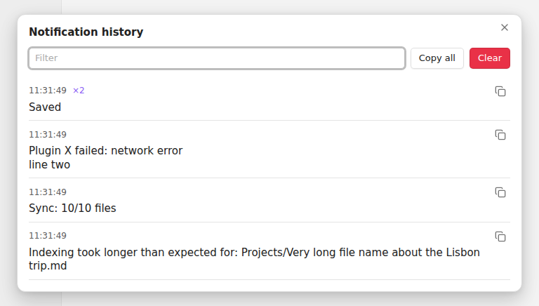

# Notification History

Obsidian's pop-up notifications disappear after a few seconds, and there is no list of them anywhere. A plugin
reports an error, a sync finishes, a file takes long to index, and if you were looking away it's gone. On desktop you
can dig through the developer console; on mobile there is nothing. ([forum request](https://forum.obsidian.md/t/67938))

This plugin keeps them.

Every notification that Obsidian or any plugin shows is saved with its time. Open the list with the bell in the
status bar, the bell in the ribbon (that one works on mobile), or the command **Show notification history**.

- Newest first. The same message shown again within 10 seconds is counted (`×2`) instead of repeated.
- Notifications that change while on screen, like progress messages, are saved with their last text.
- Filter box, a copy button on each one, **Copy all** and **Clear**.
- The status bar bell shows how many came in since you last looked.

## Settings

- **Keep history after restart**: on by default. Off keeps the list in memory only.
- **Notifications to keep**: 50 to 1000, default 200.
- **Bell in the status bar**: on by default.

The history is stored in the plugin's own `data.json` in your vault's `.obsidian` folder. Nothing leaves your device.

## Install

In Obsidian: **Settings → Community plugins → Browse**, search for "Notification History", install and enable it.

Manual install: download `main.js`, `manifest.json` and `styles.css` from the
[latest release](https://github.com/prometheus-maker/notice-history/releases/latest) into
`<vault>/.obsidian/plugins/notice-history/`.

## Limits

It records notifications from the moment it loads, so the very first ones at startup, shown before community
plugins load, are missed. It reads them from the screen, so text inside a notification is saved but buttons are not.
Tested on Obsidian 1.15 desktop (Linux); not yet on mobile.

## Licence

MIT
